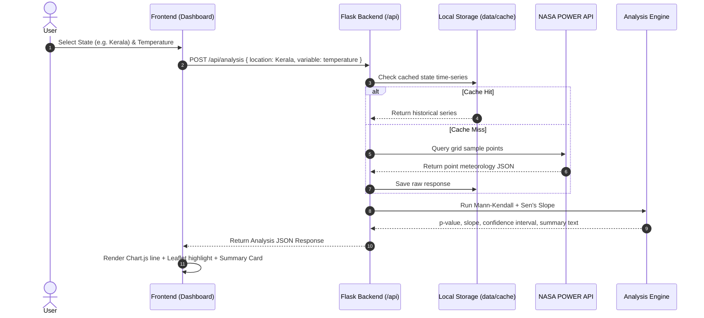

# TerraScope Architecture & Data Flow

## 1. Monorepo Structural Blueprint
TerraScope is organized as a decoupled monorepo:
- **`backend/`**: Lightweight Python service using Flask, Pandas, SciPy, and PyMannKendall. It handles data fetching, spatial point generation, statistical modeling, and plain-language formatting.
- **`frontend/`**: Zero-build, standard-compliant browser client powered by HTML5, CSS custom properties, Leaflet for vector map rendering, and Chart.js for data visualization.
- **`data/`**: Structured data layers guaranteeing deterministic offline execution when NASA services are throttled or unreachable.

```
                    +-----------------------------+
                    |    Browser Client (User)    |
                    +--------------+--------------+
                                   |
              HTTP / JSON Rest API | (Port 5000 / Proxy)
                                   v
                    +-----------------------------+
                    |     Flask Application       |
                    | (backend/app.py & config)   |
                    +--------------+--------------+
                                   |
        +--------------------------+--------------------------+
        |                          |                          |
        v                          v                          v
+------------------+      +------------------+      +------------------+
| Routes & Views   |      | Ingestion        |      | Statistical      |
| - location.py    |      | Services         |      | Engine           |
| - analysis.py    |      | - geocoding.py   |      | - processing.py  |
| - map_trends.py  |      | - nasa_power.py  |      | - trends.py      |
| - report.py      |      | - state_sampler  |      | - significance.py|
+------------------+      +--------+---------+      | - plain_language |
                                   |                +------------------+
                                   v                          |
                          +------------------+                |
                          | Caching & Store  |<---------------+
                          | - data/cache/    |
                          | - data/sample/   |
                          | - data/processed/|
                          +------------------+
```

## 2. State-Wise Spatial Aggregation Strategy
Because NASA POWER provides point queries rather than spatial state polygons:
1. **Centroid & Grid Generation** (`backend/services/state_sampler.py`):
   - For each of the 36 states/UTs, pre-compute a regular internal sampling grid ($0.5^\circ$ to $1.0^\circ$ resolution) bounded by the state GeoJSON polygon.
   - For tiny union territories (e.g. Chandigarh, Lakshadweep), use the state geographic centroid.
2. **Batch Requesting & Caching**:
   - Query points and aggregate daily metrics to monthly/annual averages per state.
   - Pre-computed state historical series are saved to `data/processed/state_averages_<variable>.json` to ensure instantaneous UI response times.
3. **Live Ad-hoc Queries**:
   - For arbitrary searched cities or villages, the backend resolves coordinates and queries the nearest NASA POWER grid point.

## 3. End-to-End Execution Sequence

